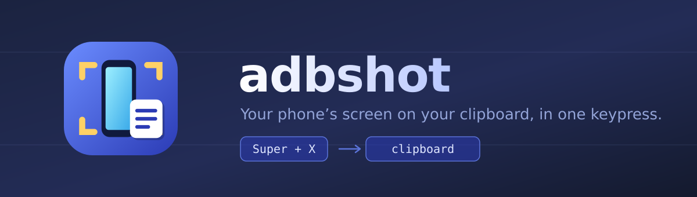
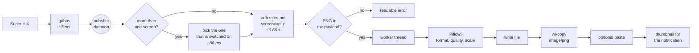

<div align="center">



**Press `Super`+`X` and your phone's screen lands on your computer's clipboard.**
No hunting for the file, no `adb pull`, no opening folders.

[](LICENSE)
[](https://www.gnome.org/)
[](https://www.python.org/)
[](#requirements)

[Install](#install) · [Usage](#usage) · [Settings](#settings) · [How it works](#how-it-works)

</div>

---

## Why

Getting a screenshot off your phone usually means: capture on the phone → wait for it to sync,
or `adb pull` → find the file → drag it over. Every single time.

**adbshot makes it one keypress.** The capture lands on your clipboard ready to paste, and is
saved to a folder of your choosing on the way.

```
Super + X  ──▶  capture over ADB  ──▶  clipboard  ──▶  Ctrl + V
                     ~0.7 s
```

## Features

|   | |
|---|---|
| ⌨️ | **Global shortcut** — `Super`+`X` by default, rebindable from the app itself |
| 📋 | **Straight to the clipboard** — pastes as an image into GIMP, chats, editors… |
| 🖼️ | **PNG, JPEG or WebP** — with 1–100 % quality and an output scale |
| 📁 | **Optional saving** — your folder, your filename template, or clipboard only |
| 📱 | **Several phones** — remembers the one you use, asks only when it matters |
| 📐 | **Foldables** — finds the screen that is switched on, so a Fold never shoots the dark one |
| 🔔 | **Subtle feedback** — shutter sound, animated tray icon, thumbnail notification |
| 🗑️ | **Safe emptying** — only ever deletes its own captures, and to the Trash |
| ⚡ | **Auto-paste** *(optional)* — with a shortcut you choose |
| 🌍 | **English and Spanish** — switchable at runtime, and easy to extend |

## Requirements

- **GNOME 46 or newer on Wayland.** The real floor is **libadwaita 1.5**, which is what provides
  `Adw.PreferencesDialog` and `Adw.AlertDialog`. In practice: Ubuntu 24.04 or later, Fedora 40 or
  later, and derivatives. On Ubuntu 22.04 (libadwaita 1.1) it **will not start**.
- An **AppIndicator** extension enabled, for the tray icon. Many distributions ship one; if yours
  does not, install
  [AppIndicator Support](https://extensions.gnome.org/extension/615/appindicator-support/).
- **USB debugging** enabled and authorised on the phone.

Install the dependencies in one line. On a GNOME desktop most are already there, but `adb` and
`wl-clipboard` live in *universe* and are rarely preinstalled:

```bash
sudo apt install python3-gi gir1.2-gtk-4.0 gir1.2-adw-1 gir1.2-notify-0.7 \
                 gir1.2-gsound-1.0 python3-pil python3-numpy wl-clipboard adb
```

| Package | What it is for |
|---|---|
| `adb` | talking to the phone |
| `wl-clipboard` | writing the image to the Wayland clipboard |
| `python3-gi`, `gir1.2-gtk-4.0`, `gir1.2-adw-1` | the UI and the daemon |
| `gir1.2-notify-0.7` | the thumbnail notification |
| `gir1.2-gsound-1.0` | the shutter sound *(without it, silence)* |
| `python3-pil` | format, quality, scale and thumbnail |
| `python3-numpy` | detecting a black capture *(without it, no warning)* |

## Install

One line. It detects your distribution, installs what is missing, and leaves adbshot running:

```bash
curl -fsSL https://raw.githubusercontent.com/acosta290/adbshot/main/install.sh | bash
```

Prefer not to give it root? This installs into `~/.local` and touches nothing else:

```bash
curl -fsSL https://raw.githubusercontent.com/acosta290/adbshot/main/install.sh | bash -s -- --user
```

The installer knows `apt`, `dnf`, `pacman` and `zypper`. It then verifies the runtime by
actually importing every dependency, so it tells you exactly what is missing rather than
trusting that a package name worked. Re-running it is safe.

<details>
<summary>Installer options</summary>

<br>

```bash
curl -fsSL .../install.sh | bash -s -- --user        # into ~/.local, no root
curl -fsSL .../install.sh | bash -s -- --prefix DIR  # somewhere else
curl -fsSL .../install.sh | bash -s -- --no-deps     # skip package installation
curl -fsSL .../install.sh | bash -s -- --ref v1.0.0  # a specific tag or branch
curl -fsSL .../install.sh | bash -s -- --uninstall   # remove it again
```

</details>

### Manual install

If you would rather see every step, or the installer does not know your distribution:

```bash
# 1. dependencies (Debian/Ubuntu names; see the table above for what each is for)
sudo apt install python3-gi gir1.2-gtk-4.0 gir1.2-adw-1 gir1.2-notify-0.7 \
                 gir1.2-gsound-1.0 python3-pil python3-numpy wl-clipboard adb

# 2. the app itself
git clone https://github.com/acosta290/adbshot
cd adbshot
sudo make install          # or: make install PREFIX=~/.local
```

Either way, finish by checking everything landed:

```bash
adbshot --self-check
```

## Usage

| I want to… | I do… |
|---|---|
| Capture | **`Super`+`X`** |
| Capture without leaving the mouse | **Middle-click** the tray icon |
| Open settings | Click the tray icon → **Preferences** (first entry) |
| Capture from a script | `adbshot --out shot.png` |

```bash
adbshot --out /tmp/x.jpg --format jpeg --quality 80 --scale 50 --clipboard
adbshot --out /tmp/x.png --display 4630946722019192211   # pin a foldable to one screen
adbshot --self-check          # full diagnostic (lists the screen ids)
adbshot --install-hotkey      # re-register the shortcut if you removed it
adbshot --help
```

## Settings

Everything lives in the preferences window, across three tabs.

**Capture** — format (PNG / JPEG / WebP), quality 1–100 %, output scale, and which device to
use when several are connected.

**Files** — destination folder, filename template
(`{modelo}` `{serie}` `{fecha}` `{hora}` `{ancho}` `{alto}`), and the empty-folder button.

**Behaviour** — interface language, clipboard mode, paste shortcut, global shortcut with live
conflict detection, and the sound and notification switches.

The interface ships in **English** and switches to Spanish, or follows your session locale, from
*Behaviour → Language*. The tray menu changes immediately; reopen Preferences to see it there.

### Auto-paste

adbshot can optionally press the paste shortcut for you right after a capture — and **you pick
the shortcut**, because not everything pastes an image with `Ctrl`+`V`:

| Target | Shortcut |
|---|---|
| Most apps | `Ctrl`+`V` |
| Claude Code CLI | `Ctrl`+`Super`+`V` |
| Yours | Whatever you record in Preferences |

It works through `org.gnome.Mutter.RemoteDesktop`: **no `sudo`, no `ydotool`, no udev rules and
no extra packages**.

> [!NOTE]
> It ships **disabled** for an honest reason: GNOME lights the panel's "screen is being shared"
> indicator and holds it for **at least 5 seconds** on every injection. It also rides on a
> compositor-internal API rather than a stable public one. Turn it on if the trade is worth it.

## How it works



One GTK 4 process, started by systemd and also D-Bus activatable, so a dead daemon is brought
back by the shortcut itself.

<details>
<summary><b>Design notes</b> — why the code looks like this and not like the obvious thing</summary>

<br>

Every one of these came from a measurement on a real machine, not an assumption. If you are
going to touch the code, these will save you hours.

**The tray icon is hand-rolled over D-Bus.** `libayatana-appindicator` depends on GTK 3, and
GTK 3 and GTK 4 cannot coexist in one Python process — it fails in both import orders.
Implementing `org.kde.StatusNotifierItem` + `com.canonical.dbusmenu` directly keeps the whole
application in a single GTK 4 process.

**`Activate` is not advertised** in the item's XML. Advertising it makes the shell wait out the
double-click timeout on *every* left click before opening the menu.

**`AboutToShow` refreshes silently.** Emitting `LayoutUpdated` while the shell is opening a
submenu makes it tear the menu down and rebuild it — the submenu flashes open and shut.

**The shortcut runs `gdbus`, not `adbshot`.** A C client costs ~2 ms; forwarding through a
second Python process costs ~40 ms and, worse, makes the shortcut-spawned process the primary,
leaving a daemon outside systemd while `systemctl` reports the unit inactive.

**`hold()` is mandatory.** Without it a `GApplication` in service mode exits after 10 s with
status 0 — which `Restart=on-failure` will not recover. The icon would vanish after every login.

**`KillMode=process` on the unit.** `wl-copy` leaves a process holding the selection that
inherits our cgroup; with the default `KillMode`, `systemctl --user restart` would silently
empty the clipboard the app just filled.

**The PNG signature is *located*, not merely tested.** `screencap` can fail with exit status 0
and a plain-text error on stdout; without the check you write a corrupt `.png` and push garbage
to the clipboard. But on a foldable it does something worse than fail: it prints `[Warning]
Multiple displays were found…` on stdout and then appends a perfectly good PNG behind it. A
`startswith` gate rejects that image; finding the signature and dropping the preamble keeps it.

**A foldable is asked which screen is on before it is captured.** With no `-d`, `screencap`
takes "the first display found" — on a Z Fold that is the cover screen, so an unfolded phone
returns a black 1080×2520 frame with no error to key on. `dumpsys display` names the one whose
`state` is `ON` (never `committedState`, which lags a fold by a frame) and whose input viewport
is live, and `-d` pins the capture to it. It wants the 64-bit id from `uniqueId="local:…"`; the
small logical ids dumpsys also prints are rejected. Single-screen phones are memoised so they
pay the ~80 ms probe once a minute rather than once a capture.

**Pillow always runs on a worker thread, in the daemon.** On the main loop it freezes it
completely while encoding — zero frames delivered, not "a bit slower". (The one-shot `--out`
mode does it inline, because there is no UI there to freeze.)

**`wl-copy` is spawned with stdout and stderr to `/dev/null`.** The process that holds the
selection inherits the write end of any pipe, so `communicate()` would wait forever.

**The GSettings schema is looked up before it is opened.** `Gio.Settings.new()` on a missing
schema kills the process with exit 133 → crash loop → failed unit → and a failed unit also
disables the D-Bus activation that existed to resurrect it.

**Auto-paste does not release modifiers before injecting.** It looks like the obvious fix for
the `Super` still held from `Super`+`X`, but a release cannot clear a modifier another device
is physically holding, and as a session's first key event it is rejected outright — aborting
the paste every time. Waiting is the only real mitigation.

</details>

## Troubleshooting

```bash
adbshot --self-check
systemctl --user status adbshot
journalctl --user -u adbshot -b
```

| Symptom | Usual cause |
|---|---|
| No tray icon | No AppIndicator extension enabled, or the session is locked |
| `Super`+`X` does nothing | Run `adbshot --install-hotkey` and check for a conflict |
| The capture is black | The foreground app blocks screenshots (`FLAG_SECURE`), or the screen is off |
| A foldable shoots the wrong screen | `adbshot --self-check` lists both ids and marks the one it picked |
| "unauthorized" | Accept the USB debugging prompt on the phone |
| Service will not start | `systemctl --user reset-failed adbshot && systemctl --user start adbshot` |
| Interface is in the wrong language | *Preferences → Behaviour → Language* (default is English) |

## Uninstall

```bash
curl -fsSL https://raw.githubusercontent.com/acosta290/adbshot/main/install.sh | bash -s -- --uninstall
```

Or from a checkout:

```bash
sudo make uninstall      # keeps your screenshots and settings
sudo make purge          # also resets the settings
```

Either way your captures in `~/Pictures/adbshot` are never touched.

## Missing something? Ask for it

This tool grows from what people actually need it to do.

- **Want a feature?** [Open a feature request](https://github.com/acosta290/adbshot/issues/new?template=feature_request.yml)
  and describe what you are trying to get done. If it fits, we will try to build it.
- **Hit a bug?** [Open a bug report](https://github.com/acosta290/adbshot/issues/new?template=bug_report.yml).
  The form asks for the output of `adbshot --self-check` and of `journalctl --user -u adbshot -b`,
  which is usually enough to find the problem straight away.

No idea is too small — a shortcut you keep wishing existed, a format that is missing, an
awkward step in your workflow. Between all of us this becomes a better tool.

## Contributing

Pull requests are welcome too, in English or Spanish.

**Adding a language** takes one dictionary. Copy `SPANISH` in
[`src/adbshot/translations.py`](src/adbshot/translations.py), translate the values, register it in
`CATALOGUES`, and add the code to `LANGUAGES` in `i18n.py`. Source strings are English, so leaving
an entry out simply falls back to English — a partial translation is perfectly usable, and there
is no `.po` workflow, no build step and no compiled catalogue to install.

Run `make lint` before opening a PR. It checks that every module compiles and that nothing
shadows gettext's `_`, which is a silent, easy mistake in Python.

Before publishing your own fork, point the project URL at it:

```bash
sudo make install HOMEPAGE=https://github.com/your-user/adbshot
```

## License

[MIT](LICENSE) — do as you like with it.

<div align="center">
<br>

</div>
